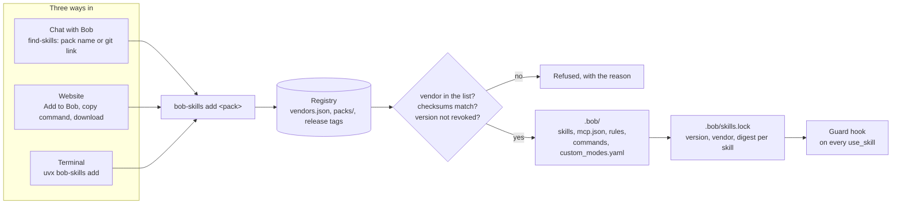
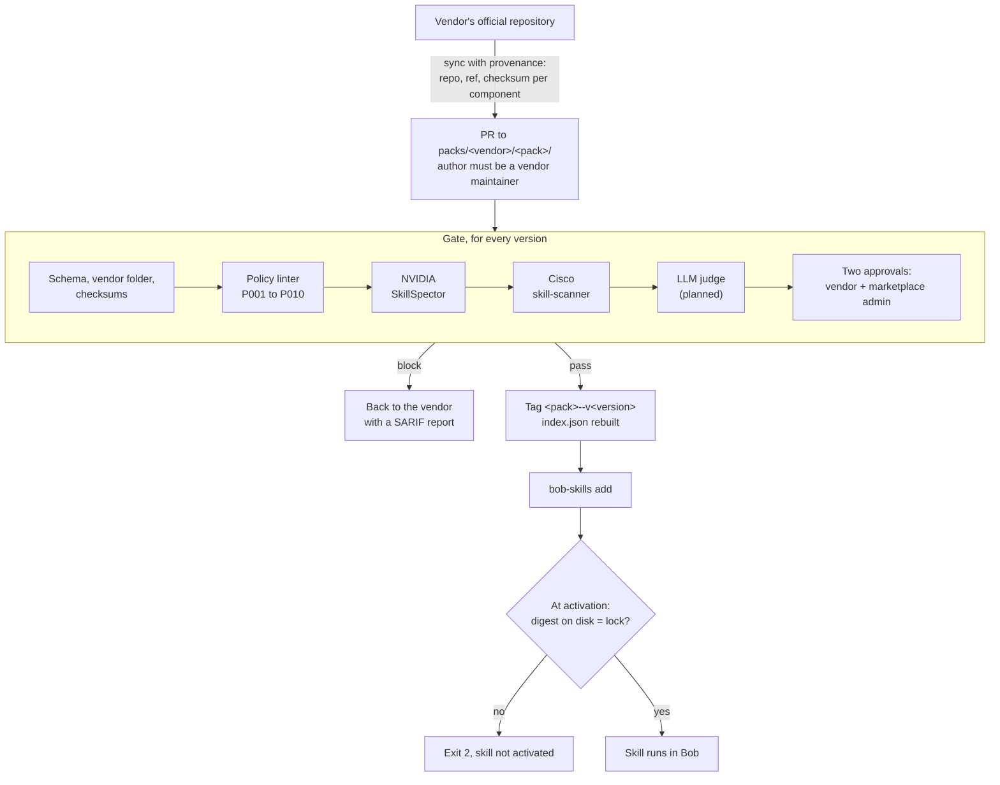
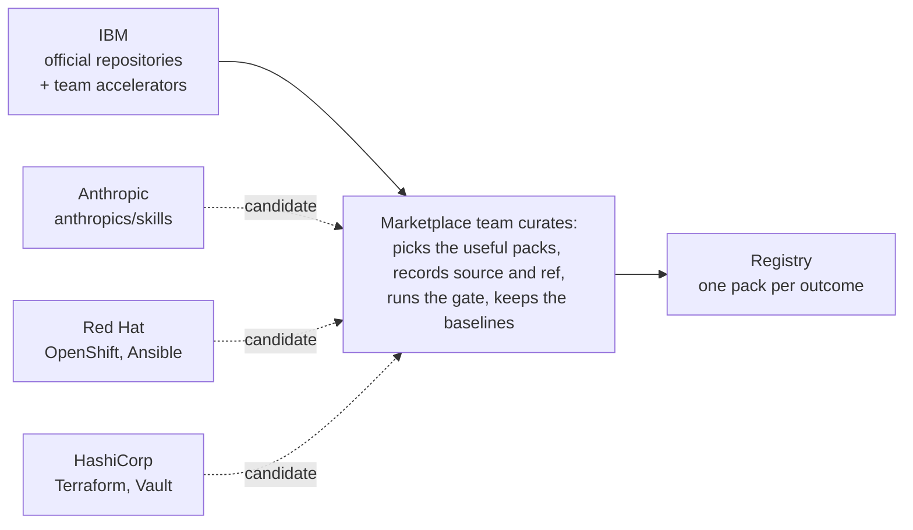
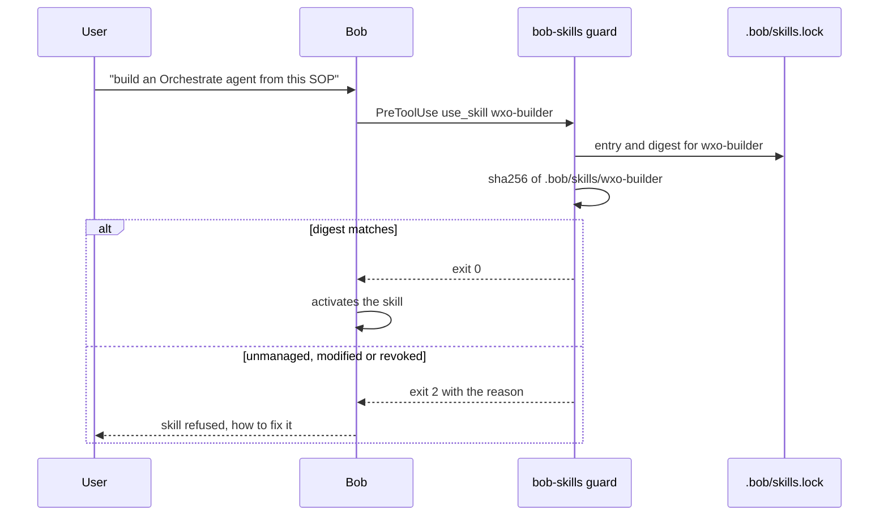

# Bob Skills Marketplace

One trusted place to get skills for [IBM Bob](https://bob.ibm.com). A few official vendors, IBM packs curated from official repositories, every version through a scanner gate, and three ways to install that all end in the same verified pack and the same lock entry.

Team entry for the IBM Bob Innovation Challenge, Israel 2026. First pack: **watsonx Orchestrate**.

## The idea in four points

- **A few official vendors.** Only large, reliable vendors publish, each for its own products: IBM first, then candidates such as Anthropic, Red Hat and HashiCorp. Packs are grouped by outcome ("talk with your data on watsonx Orchestrate"), not by repository.
- **Curated IBM packs.** IBM is a vendor like the others. Its packs are curated from official IBM repositories with recorded provenance (source repository, tag, checksum per component) and include the team's own accelerators.
- **Every pack goes through a scanner gate.** Schema and checksums, a policy linter, NVIDIA SkillSpector, Cisco skill-scanner and two human approvals, for every version. Results are shown on the pack page, risk scores included, also for official vendor skills. After install, a lock file and a guard hook refuse anything unknown or modified.
- **Three ways in, one registry.** Ask Bob in chat, paste a git link, run the CLI, or click "Add to Bob" on the website.

## Three ways in, one registry



The website mockup (catalog, pack page, install from chat) lives in [docs/images](docs/images):

| Catalog | Pack page | Install from chat |
|---|---|---|
| [](docs/images/site-catalog.png) | [](docs/images/site-pack.png) | [](docs/images/bob-chat-install.png) |

In chat, `find-skills` maps a pasted git URL to the pack whose source it is and shows what will be installed before asking for confirmation. A repository that is not in the registry is refused, with three ways forward: the closest pack, a pack request to the vendor, or `bob-skills trust` for the user's own skill.

## From a vendor's repository to a running skill



Accepted false positives live in a reviewed per-pack baseline (`.policy-baseline.json`), keyed by the path inside the pack and the line text, so they survive installation and expire as soon as the line changes. The gate fails only on new findings.

## Vendors and curation

The registry does not wait for vendors to open PRs. The marketplace team curates packs from each vendor's official repositories, records where every file came from, runs the gate, and keeps the baselines. Vendors keep ownership: `vendors.json` names their organisation, maintainers, signing key and network allow-list, and CODEOWNERS gives them the last word on their folder.



| Pack | Vendor | Status | Contents |
|---|---|---|---|
| [`wxo-adk`](packs/ibm/wxo-adk) | IBM | released 1.0.0 | 6 official ADK skills (solution-architect, sop-builder, wxo-builder, wxo-analyzer, telemetry-analyzer, agent-instructions-evaluator), MCP servers `wxo-adk` and `wxo-docs`, ADK rule, `/wxo-deploy`, mode `wxo-builder` |
| [`bob-essentials`](packs/ibm/bob-essentials) | IBM (marketplace team) | released 1.0.0 | find-skills, skill-creator, guard, `/skills-add` |
| [`wxo-talk-with-your-data`](packs/ibm/wxo-talk-with-your-data) | IBM | released 1.0.0 | excel-to-wxo-agent, wxo-chat-demo-page, ADK and docs MCP servers, data-agent rule. 1.1: database sources (Db2, PostgreSQL), Orchestrate refresh flow |
| `app-modernization` | IBM | planned | UI modernization skills (IBM/ui-modernization-lab), application code modernization |
| `building-blocks` | IBM | planned | Bob modes from IBM Client Engineering: agent builder, RAG builder, text-to-SQL, data quality |
| `office-docs` | Anthropic | candidate | Word, PowerPoint, Excel and PDF skills from anthropics/skills |
| `openshift-ansible`, `terraform-vault` | Red Hat, HashiCorp | candidate | source repositories to confirm |

## Even official skills need checking

Public catalogs report roughly a quarter of skills with security findings (NVIDIA SkillSpector data: 26.1 % with vulnerabilities, 5.2 % likely malicious). Official skills are not exempt from review. Syncing the six ADK skills from IBM's own repository produced this on the marketplace policy linter alone:

| Finding class | Count | Verdict after review |
|---|---|---|
| Third-party hostnames in documentation examples (Milvus, Elasticsearch, Salesforce, Google APIs) | 13 | accepted: instructions only, no script contacts them |
| `.env` reads in telemetry scripts | 9 | accepted: dotenv load of ADK credentials, network goes to the ADK client's base URL only |
| "without asking" in an instruction | 1 | accepted: a flow tool takes a document input directly, not a confirmation bypass |

All 23 entries sit in [the pack's baseline](packs/ibm/wxo-adk/.policy-baseline.json) with a reason each. A future ADK version that adds a new finding fails the gate until someone reads it. The client test suite replays the five red-team cases from the plan (exfiltration script, hidden Unicode, hook removal, typosquatting, tampering after install) and all five are refused.

## Guard at runtime



`bob-skills verify` recomputes digests and re-runs the linter on installed skills; `bob-skills check --brief` prints one status line at session start. An organisation makes the guard mandatory through an EnforcedHooks policy with `--no-local`.

## Website

[`site/index.html`](site/index.html) is the catalog as a static page: it reads `index.json`, renders the packs with filters and search, a page per pack with contents, gate status, versions and the install panel, and a vendors page. No build step and no server code.

- Locally: run `python3 -m http.server` in the registry checkout and open `http://localhost:8000/site/`.
- GitHub Pages: Settings → Pages → deploy from branch `main`, folder `/` (root); the site is then at `https://pages.github.ibm.com/<owner>/<repo>/site/`. `.nojekyll` at the root keeps Pages from processing the files.
- "Add to Bob" copies `/skills-add <pack>` to the clipboard. A deep link that opens Bob directly is pending the day-one check of Bob IDE's URL handling.

## Quick start

```bash
uvx bob-skills search orchestrate   # what is there
uvx bob-skills add wxo-adk          # install: vendor + checksums verified, lock written
uvx bob-skills verify               # digests and policy linter on what is installed
uvx bob-skills update               # newer versions with SKILL.md diffs, revocations
```

Inside Bob: `/skills-add wxo-adk`. Until the package is on an index, run it from the checkout:

```bash
uv run --project /path/to/bob-skills-marketplace/cli bob-skills add wxo-adk --registry /path/to/bob-skills-marketplace
```

## Repository layout

```
vendors.json            closed vendor list: ids, GitHub orgs, maintainers, keys, network allow-lists
CODEOWNERS              vendor folders are owned by vendor maintainers
schemas/                JSON schemas for pack.json, vendors.json, index.json
packs/<vendor>/<pack>/  pack.json, skills/, rules/, commands/, custom_modes.yaml, .policy-baseline.json
index.json              generated search index (bob-skills registry build-index)
marketplace.json        generated compatibility manifest for other agents
cli/                    the bob-skills client (Python, typer); also the linter and registry tools
scripts/                sync_adk_skills.py, CI helpers
docs/                   pack format, security gate, vendor onboarding, Bob integration, team plan, mockup images
site/                   static catalog website reading index.json
.github/                gate and release workflows, pack request template
```

Working on the registry:

```bash
uv run --project cli pytest -q                          # client tests, including the red-team cases
uv run --project cli bob-skills registry validate --fix # schemas, vendors, checksums
uv run --project cli bob-skills registry build-index    # index.json + marketplace.json
uv run --project cli bob-skills lint packs              # policy linter, honours .policy-baseline.json
```

## Status and next steps

Done: registry with vendor `ibm` and three candidate vendors, three released packs, the client with install, update, verify, guard, linter, `resolve` (git link to pack), `show` (what will be installed) and first-vendor confirmation, the find-skills marketplace skill with a generated offline catalog, CI workflows, docs, the static website.

Next, in order:

1. Enable GitHub Pages for the site; confirm Bob IDE URL handling for an "Add to Bob" deep link.
2. `wxo-talk-with-your-data` 1.1 with database sources and the Orchestrate refresh flow; upstream the two policy fixes to the excel-to-wxo repository.
3. Candidate packs: `office-docs` from anthropics/skills, `app-modernization` from IBM/ui-modernization-lab.
4. Day-one checks from the plan: the `use_skill` hook payload carries the skill name; SkillSpector JSON shape for the threshold script.

## Docs

- [Pack format, checksums, lock file](docs/pack-format.md)
- [Security gate: layers, thresholds, baselines](docs/security-gate.md)
- [Vendor onboarding](docs/vendor-onboarding.md)
- [Bob integration: hooks, commands, what to verify on day one](docs/bob-integration.md)
- [Team plan for the challenge (Russian)](docs/marketplace-plan.md)

The vendored ADK skills are MIT-licensed by IBM (see `packs/ibm/wxo-adk/skills/LICENSE`). This repository is a hackathon team project and is not an IBM product.
