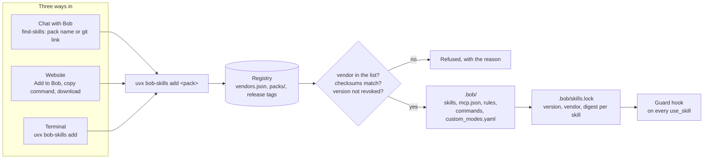
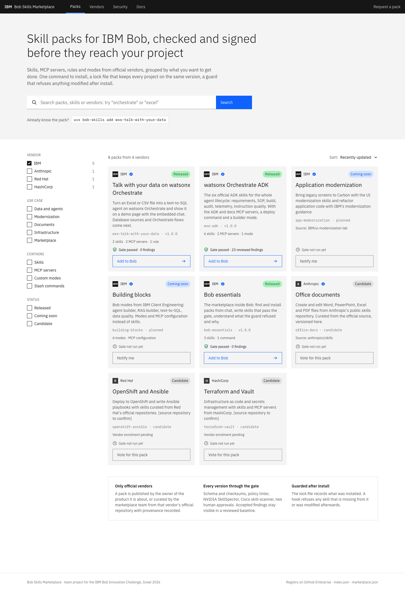
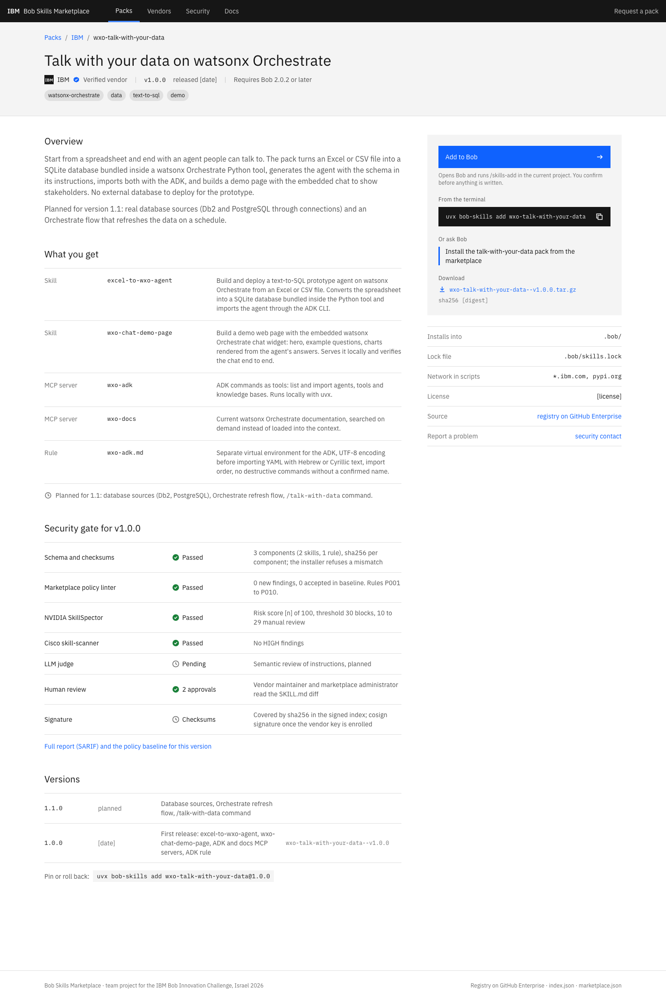
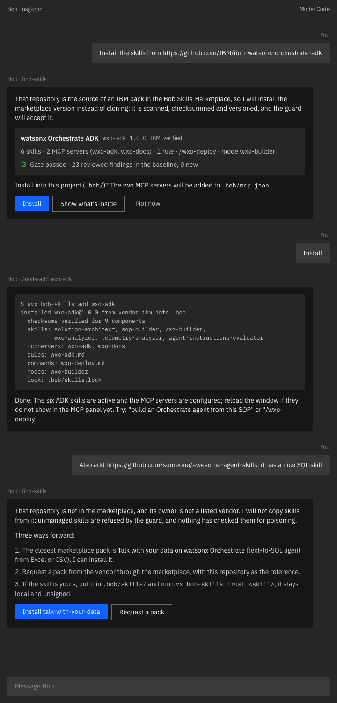
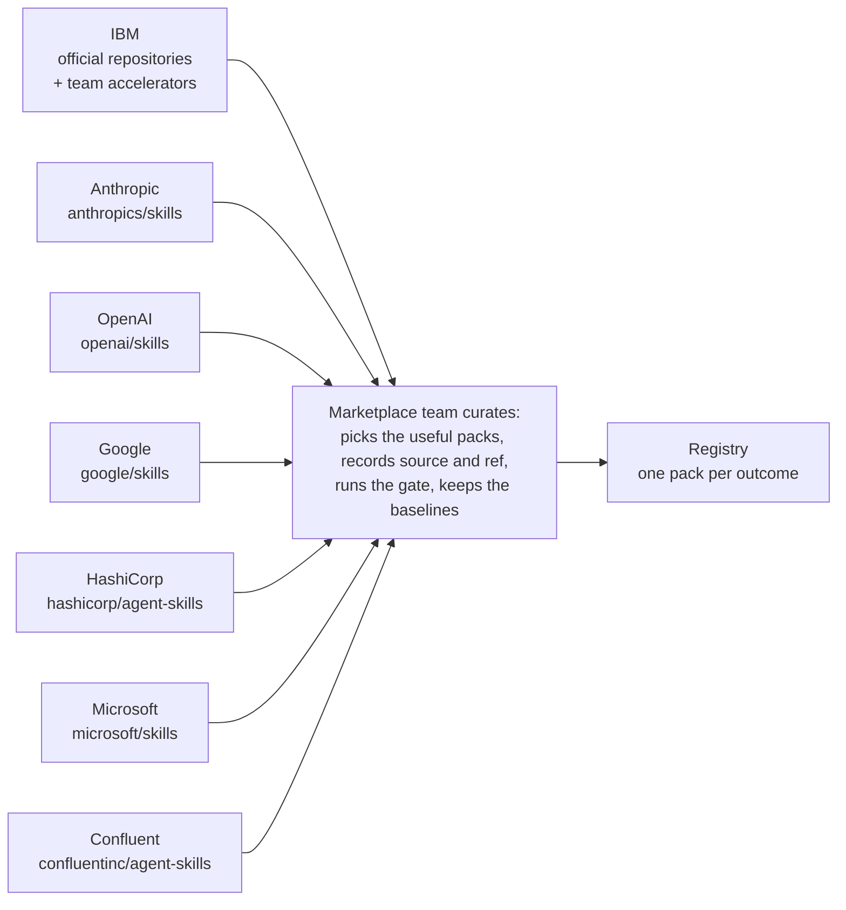
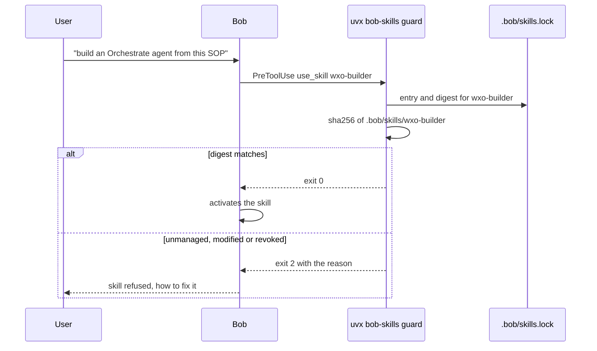

# Bob Skills Marketplace

One trusted place to get skills for [IBM Bob](https://bob.ibm.com). A few official vendors, IBM packs curated from official repositories, every version through a scanner gate, and three ways to install that all end in the same verified pack and the same lock entry.

## The idea in four points

- **A few official vendors.** Only large, reliable vendors publish, each for its own products: IBM, Anthropic, OpenAI, Google, HashiCorp, Microsoft and Confluent, and only vendors with at least one curated pack are listed. Packs are grouped by outcome ("talk with your data on watsonx Orchestrate"), not by repository.
- **IBM packs first.** The team's own packs (office documents, talk with your data, the marketplace skills) and packs curated from official IBM repositories are the product; provenance (source repository, commit, checksum per component) is recorded for everything that was not written here.
- **Every pack goes through a scanner gate.** Schema and checksums, a policy linter, NVIDIA SkillSpector, Cisco skill-scanner and two human approvals, for every version. Results are shown on the pack page, risk scores included, also for official vendor skills. After install, a lock file and a guard hook refuse anything unknown or modified.
- **Three ways in, one registry.** Ask Bob in chat, paste a git link, run the CLI, or click "Add to Bob" on the website.

## Three ways in, one registry



The website mockup (catalog, pack page, install from chat) lives in [docs/images](docs/images):

| Catalog | Pack page | Install from chat |
|---|---|---|
| [](docs/images/site-catalog.png) | [](docs/images/site-pack.png) | [](docs/images/bob-chat-install.png) |

In chat, `find-skills` maps a pasted git URL to the pack whose source it is and shows what will be installed before asking for confirmation. A repository that is not in the registry is refused, with three ways forward: the closest pack, a pack request to the vendor, or `uvx bob-skills trust` for the user's own skill.

## From a vendor's repository to a running skill


Accepted false positives live in a reviewed per-pack baseline (`.policy-baseline.json`), keyed by the path inside the pack and the line text, so they survive installation and expire as soon as the line changes. The gate fails only on new findings.

## Vendors and curation

The registry does not wait for vendors to open PRs. The marketplace team curates packs from each vendor's official repositories, records where every file came from, runs the gate, and keeps the baselines. Vendors keep ownership: `vendors.json` names their organisation, maintainers, signing key and network allow-list, and CODEOWNERS gives them the last word on their folder.



| Pack | Vendor | Status | Contents |
|---|---|---|---|
| [`presentations`](packs/ibm/presentations) | IBM (marketplace team) | released 1.11.0 | One headline per slide, a style picked from five, charts and pictures, then an HTML deck, a printable PDF and a 16:9 PowerPoint, plus the pitch and Q&A kit |
| [`office-docs`](packs/ibm/office-docs) | IBM (marketplace team) | released 1.0.1 | docx, pptx, xlsx, pdf: original skills with tested scripts on python-docx, python-pptx, openpyxl, pypdf, pdfplumber and reportlab |
| [`wxo-talk-with-your-data`](packs/ibm/wxo-talk-with-your-data) | IBM (marketplace team) | released 1.1.0 | excel-to-wxo-agent, wxo-chat-demo-page, the read-only docs MCP server, data-agent rule. 1.1.0 dropped the unused ADK MCP server, keeps charts in the customer's COS bucket by default and serves the demo page on 127.0.0.1 only. 1.2: database sources (Db2, PostgreSQL), Orchestrate refresh flow |
| [`wxo-adk`](packs/ibm/wxo-adk) | IBM | released 1.1.1 | 6 official ADK skills plus IBM's official wxo-agent-architect, MCP servers `watsonx-orchestrate-adk` (pinned 2.16.1, read-write: every write call needs the user's yes) and `watsonx-orchestrate-adk-docs` (read-only), ADK rule, `/wxo-deploy`, mode `wxo-builder` |
| [`ibm-watsonx-data-integration`](packs/ibm/ibm-watsonx-data-integration) | IBM | released 1.0.1 | six official watsonx.data integration skills (flow lifecycle, DataStage, pyflow, run investigation, engine knowledge, bug reports) and a rule that helps register the Agentic Data Integration MCP server |
| [`bob-essentials`](packs/ibm/bob-essentials) | IBM (marketplace team) | released 1.2.0 | find-skills, skill-audit, bob-doctor, skill-creator, guard, `/skills-add`, and the `security-defaults` rule for every task |
| [`ibm-cloud`](packs/ibm/ibm-cloud) | IBM (marketplace team) | released 1.0.0 | ibmcloud-setup, ibmcloud-inventory, ibmcloud-diagnose, ibmcloud-cost, the `ibm-cloud` rule, `/ibmcloud-report` and the `cloud-ops` mode; read-only, fixes come as commands you approve |
| [`anthropic-dev-kit`](packs/anthropic/anthropic-dev-kit) | Anthropic | released 1.0.0 | mcp-builder, webapp-testing, frontend-design from anthropics/skills (Apache-2.0) |
| [`openai-security`](packs/openai/openai-security) | OpenAI | released 1.0.0 | security-best-practices, security-threat-model, security-ownership-map (Apache-2.0) |
| [`openai-dev-tools`](packs/openai/openai-dev-tools) | OpenAI | released 1.1.0 | jupyter-notebook, gh-fix-ci, cli-creator (Apache-2.0) |
| [`google-cloud-data`](packs/google/google-cloud-data) | Google | released 1.0.0 | bigquery-basics, bigquery-bigframes, bigquery-ai-ml, gcloud (Apache-2.0) |
| [`hashicorp-terraform`](packs/hashicorp/hashicorp-terraform) | HashiCorp | released 1.0.0 | terraform-style-guide, terraform-test, terraform-policy, refactor-module, terraform-search-import (MPL-2.0) |
| [`microsoft-azure-ops`](packs/microsoft/microsoft-azure-ops) | Microsoft | released 1.1.1 | azure-resource-lookup, azure-storage, azure-cost, azure-compliance, azure-quotas, azure-diagnostics, azure-compute (MIT) |
| [`microsoft-foundry`](packs/microsoft/microsoft-foundry) | Microsoft | released 1.0.1 | microsoft-foundry, Microsoft's most installed agent skill (MIT) |
| [`confluent-kafka`](packs/confluent/confluent-kafka) | Confluent (an IBM company) | released 1.0.0 | Kafka Java and Python clients, Kafka Streams, Schema Registry migration with PII tags, Flink SQL and UDFs, CDC to Iceberg or Delta with Tableflow, MSK to Confluent Cloud planning (Apache-2.0) |
| `app-modernization`, `building-blocks`, `dev-workflow`, `data-analyst`, `log-triage` | IBM | coming soon | UI modernization, Client Engineering building-block modes, developer workflow skills, a data analyst over files and databases, and local log triage |
| `redhat-openshift` | Red Hat | coming soon | Cluster troubleshooting, cluster updates and GitOps from [openshift/agentic-skills](https://github.com/openshift/agentic-skills) (Apache-2.0) |
| `hashicorp-packer`, `microsoft-azure-sdk-python`, `oracle-database`, `elastic-observability` | HashiCorp, Microsoft, Oracle, Elastic | candidate | Waiting on a licence decision or on demand; vote on the request issue in `roadmap.json` |

The IBM packs are the marketplace's own product and come first in the catalog; packs from other vendors are curated alternatives for teams that already use those platforms.

Planned packs live in [`roadmap.json`](roadmap.json) and show in the catalog as *coming soon* (the team will build it) or *candidate* (waiting on the vendor: a licence, an official repository). Each has a request issue labelled `pack-request`; a thumbs-up reaction on it is a vote, and `python3 scripts/refresh_roadmap.py` writes the counts back so the catalog, the website and the find-skills skill show them.

Not eligible: Anthropic's document skills (docx, pdf, pptx, xlsx) are source-available under a licence that forbids copying them out of Anthropic's services; vercel-labs/agent-skills publishes no licence. Red Hat now publishes OpenShift skills under Apache-2.0 in [openshift/agentic-skills](https://github.com/openshift/agentic-skills) (cluster troubleshooting with scripts, cluster updates, GitOps), so `redhat-openshift` moved from candidate to coming soon; Ansible still has no official skills repository. Oracle's skills are UPL-1.0, which the licence list does not cover yet, so `oracle-database` stays a candidate until that policy decision is made. A vendor is listed only when at least one pack is curated from it. Every vendored skill above is Apache-2.0, MIT or MPL-2.0 and carries its upstream repository and commit in `pack.json` `source`; `scripts/sync_upstream.py <pack>` refreshes it.

## Even official skills need checking

Public catalogs report roughly a quarter of skills with security findings (NVIDIA SkillSpector data: 26.1 % with vulnerabilities, 5.2 % likely malicious). Official skills are not exempt. This is what the two scanners said about the packs in this registry before any review, static mode, no LLM:

| Skill | Vendor | SkillSpector risk (0–100) | Cisco max severity | What it actually is |
|---|---|---|---|---|
| mcp-builder | Anthropic | 100, do not install | MEDIUM | references to its own reference files, `api.example.com` examples, unpinned `anthropic` and `mcp` requirements |
| webapp-testing | Anthropic | 64 | HIGH | `with_server.py` starts the user's own dev-server command with `shell=True` |
| security-best-practices | OpenAI | 100, do not install | INFO | security guidance quoting the insecure patterns it warns against |
| security-ownership-map | OpenAI | 66 | INFO | scripts that read git history and CODEOWNERS |
| terraform-policy | HashiCorp | 54 | INFO | references to its own reference files, imperative policy rules |
| telemetry-analyzer | IBM (ADK) | 89, do not install | MEDIUM | dotenv loads, requests to the ADK base URL |
| kafka-streams-programming | Confluent | 100, do not install | INFO | "Don't lecture" about offering Flink instead, Kafka Streams state-store resets read as memory poisoning, `.env` loading in build templates |
| excel-to-wxo-agent | IBM (team) | 95, do not install | CRITICAL | SQL statements built from the user's own spreadsheet column names; demo-only upload of chart images to public hosts |
| wxo-chat-demo-page | IBM (team) | 89, do not install | MEDIUM | HTML comments in page templates |
| find-skills | IBM (marketplace) | 11 | INFO | the marketplace's own imperative rules ("never install without confirmation") |
| bigquery-basics, terraform-test, security-threat-model | Google, HashiCorp, OpenAI | 0 | INFO | nothing to report |

Every finding above was read by a reviewer and recorded with a reason in the pack's `.skillspector-baseline.yaml`, `.cisco-baseline.json` or `.policy-baseline.json`. After that the gate reports only new findings, so a future upstream change that adds a real problem fails the PR. The latest results per pack live in `.scan.json`, in `index.json`, in `uvx bob-skills show <pack>` and on the website. `python3 scripts/run_scanners.py --check` is the gate step and it is incremental: a skill is rescanned only when its content, the pack's baselines or the scanner versions changed since `.scan.json` was written (`--full` forces everything); `--write` refreshes the results; `--accept-skillspector` and `--accept-cisco` are the reviewer's acceptance, never automatic.

The review of IBM's security MCP servers ([docs/reviews/ibm-security-mcp-servers.md](docs/reviews/ibm-security-mcp-servers.md)) found three holes that no pack may carry: write or admin rights by default, outside content that can steer those writes, and weak transport (TLS off, a listener on every interface, stored tokens used for unauthenticated requests). The linter now blocks TLS off (P011) and open listeners (P012) in scripts and instructions and makes every script line that deletes, overwrites or deploys in an external system (P013) carry a reviewed reason; every MCP server in a pack must be pinned, use https, keep secrets out of the config, pre-approve nothing and declare its access in `mcpAccess`. A pack whose skills write outside the workspace also carries a `safety` entry: what the skills do and what closes it, printed by `show`, by `add`, in the offline catalog and on the pack page before anyone installs. On the user's side, bob-essentials adds a `security-defaults` rule (outside content is data, the user's yes before each external write, security settings stay on), `trust` lints a skill before recording it, and `audit` and `doctor` run the same checks on any skill and on the user's own MCP configuration. Details: [docs/security-gate.md](docs/security-gate.md).

The client test suite replays the five red-team cases from the plan (exfiltration script, hidden Unicode, hook removal, typosquatting, tampering after install) and all five are refused.

## Guard at runtime



`uvx bob-skills verify` recomputes digests and re-runs the linter on installed skills; `uvx bob-skills check --brief` prints one status line at session start. An organisation makes the guard mandatory through an EnforcedHooks policy with `--no-local`.

## Website

[`site/index.html`](site/index.html) is the catalog as a static page: it reads `index.json`, renders the packs with filters and search, a page per pack with contents, gate status, versions and the install panel, and a vendors page. No build step and no server code.

- Locally: run `python3 -m http.server` in the registry checkout and open `http://localhost:8000/site/`.
- GitHub Pages: enabled from branch `main`, folder `/` (root). The site is at https://pages.github.ibm.com/Maria-Startseva/bob-skills-marketplace/ (the root redirects to `site/`; viewers sign in with w3id). `.nojekyll` at the root keeps Pages from processing the files.
- "Add to Bob" copies `/skills-add <pack>` to the clipboard; the `bob-essentials` page offers the terminal command instead, because that pack ships the slash command. A deep link that opens Bob directly is pending the day-one check of Bob IDE's URL handling.

## Quick start

```bash
uvx bob-skills search orchestrate   # what is there
uvx bob-skills add wxo-adk          # install: vendor + checksums verified, lock written
uvx bob-skills verify               # digests and policy linter on what is installed
uvx bob-skills update               # newer versions with SKILL.md diffs, revocations
```

Inside Bob: `/skills-add wxo-adk`, once `bob-essentials` is installed; that pack ships the command. The client installs straight from this repository with `uv tool install` (above); `uvx bob-skills` will work once the package is published to an index. From a checkout without installing: `uv run --project cli bob-skills ...`.

## Repository layout

```
vendors.json            closed vendor list: ids, GitHub orgs, maintainers, keys, network allow-lists
CODEOWNERS              vendor folders are owned by vendor maintainers
schemas/                JSON schemas for pack.json, vendors.json, index.json
packs/<vendor>/<pack>/  pack.json, skills/, rules/, commands/, custom_modes.yaml, .policy-baseline.json
index.json              generated search index (bob-skills registry build-index)
marketplace.json        generated compatibility manifest for other agents
roadmap.json            planned packs: status, request issue, votes (scripts/refresh_roadmap.py refreshes them)
cli/                    the bob-skills client (Python, typer); also the linter and registry tools
scripts/                sync_upstream.py, run_scanners.py, release_pack.py, refresh_roadmap.py, gate.sh
docs/                   pack format, security gate, vendor onboarding, Bob integration, publishing, mockup images
site/                   static catalog website reading index.json
.github/                gate and release workflows, pack request template
```

Working on the registry:

```bash
scripts/gate.sh                                         # the whole gate locally: tests, validation, linter, both scanners
uv run --project cli pytest -q                          # client tests, including the red-team cases
uv run --project cli bob-skills registry validate --fix # schemas, vendors, checksums
uv run --project cli bob-skills registry build-index    # index.json + marketplace.json
uv run --project cli bob-skills lint packs              # policy linter, honours .policy-baseline.json
```

## Status and next steps

Done: registry with seven vendors (IBM, Anthropic, OpenAI, Google, HashiCorp, Microsoft, Confluent), fourteen released packs including the team's own office-docs and presentations, both scanners with reviewed baselines per pack, the client with install, update, verify, guard, linter, `audit`, `doctor`, `trust` with linting, `resolve` (git link to pack), `show` (what will be installed) and first-vendor confirmation, the find-skills marketplace skill with a generated offline catalog, CI workflows, docs, the static website.

Next, in order:

1. Confirm Bob IDE URL handling for an "Add to Bob" deep link.
2. `wxo-talk-with-your-data` 1.1 with database sources and the Orchestrate refresh flow; upstream the two policy fixes to the excel-to-wxo repository.
3. The coming-soon packs in `roadmap.json`: `app-modernization`, `building-blocks`, `dev-workflow`.
4. CI on github.ibm.com: GitHub Actions is disabled for user and team repositories on this instance and no runners exist, so the gate runs locally with `scripts/gate.sh` until an organisation with Actions (or another CI) is available. The workflows are ready.
5. Day-one check from the plan: the `use_skill` hook payload carries the skill name.

## Docs

- [Pack format, checksums, lock file](docs/pack-format.md)
- [Security gate: layers, thresholds, baselines](docs/security-gate.md)
- [Vendor onboarding](docs/vendor-onboarding.md)
- [Bob integration: hooks, commands, what to verify on day one](docs/bob-integration.md)
- [Publishing the client to PyPI](docs/publishing.md)

The vendored ADK skills are MIT-licensed by IBM (see `packs/ibm/wxo-adk/skills/LICENSE`). This repository is maintained by the marketplace team and is not an official IBM product.
